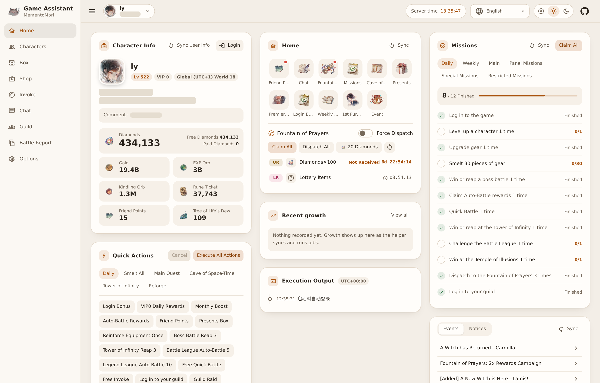
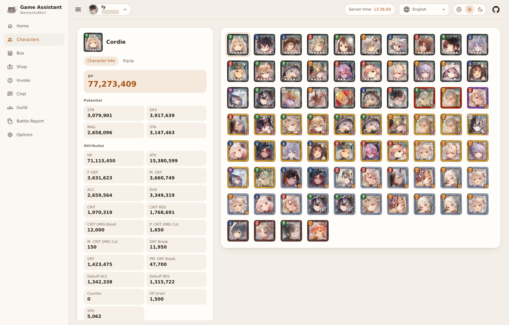
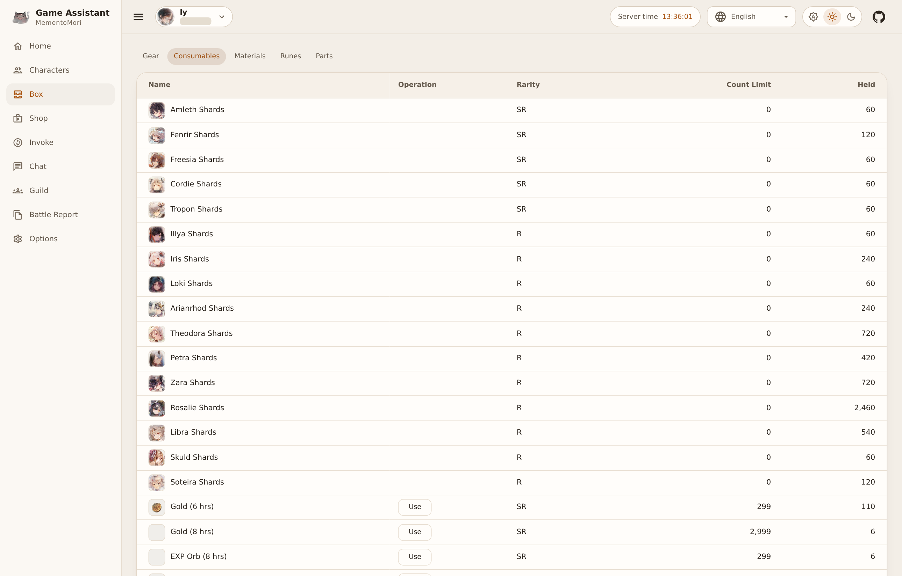
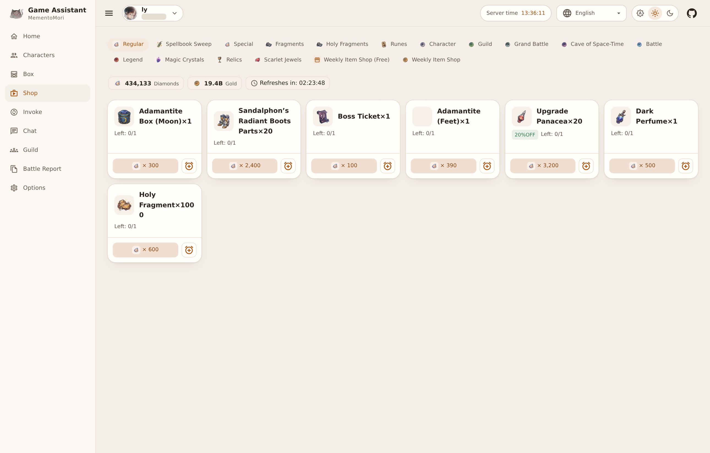
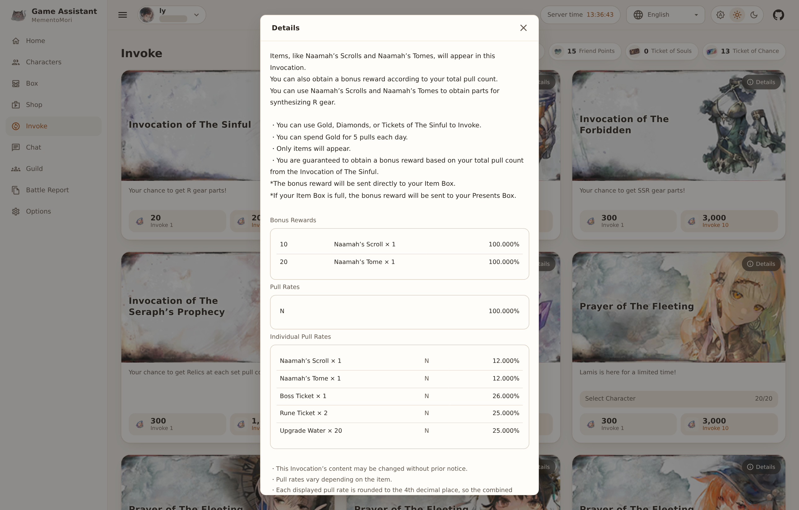
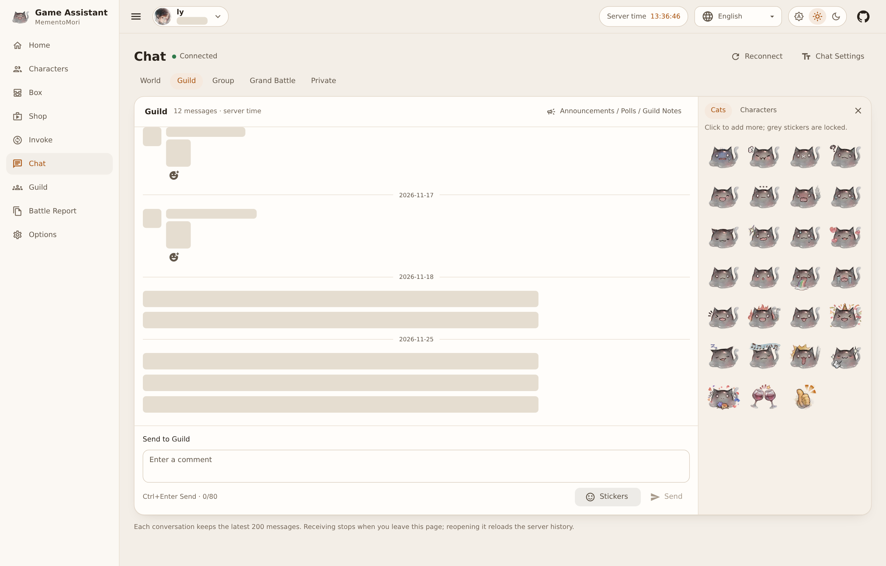
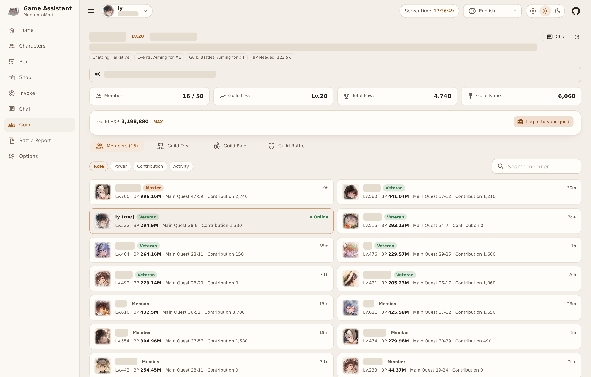
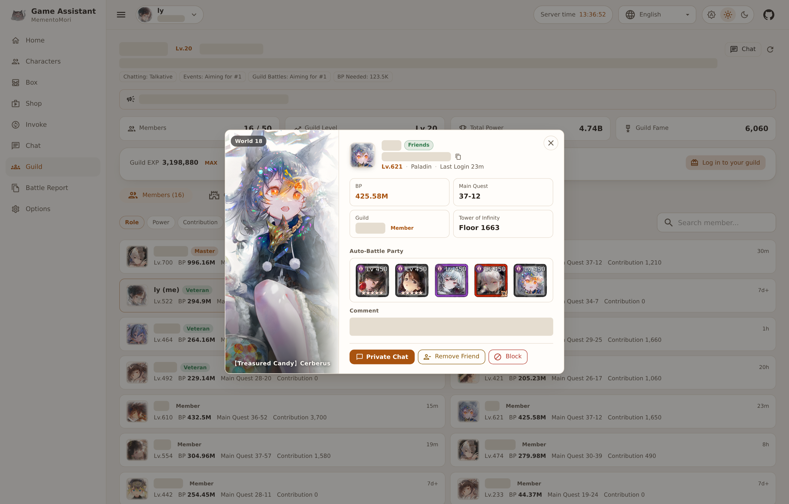
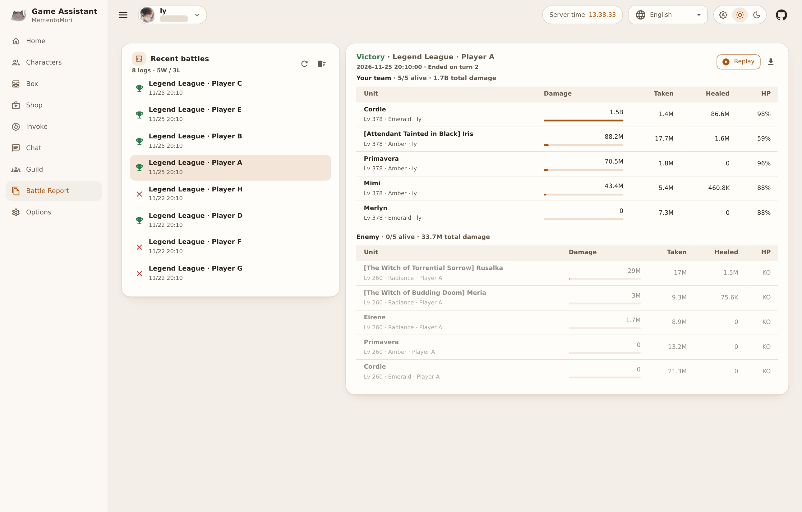
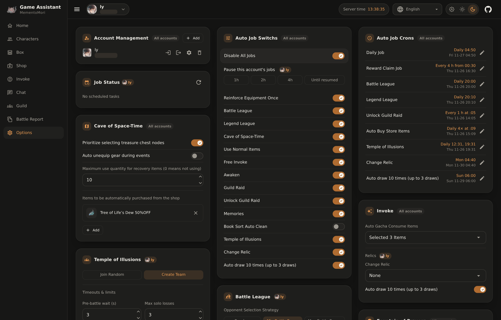

[ [Zh](readme.md) | [En](readme.en.md) ]

# MementoMori Game Assistant

[](https://github.com/lyaurora/mementomori-helper/actions/workflows/publish-dev.yml)
[](https://github.com/lyaurora/mementomori-helper/releases/latest)

A cross-platform assistant for Memento Mori: it claims rewards and runs dailies on a schedule, and lets you view characters, items, guild overview, battle summaries and player profiles, as well as buy, invoke and chat from a browser or the Android app.

This is a maintained fork of [moonheart/mementomori-helper](https://github.com/moonheart/mementomori-helper) that keeps the original Blazor WebUI and MAUI Android app. It runs on .NET 10, its game protocol is synced to client **5.2.0**, and the UI is available in English, 简体中文, 繁體中文, 日本語 and 한국어 (with automatic English fallback for missing Master text entries). Prebuilt packages are published for Windows / Linux / macOS, multi-arch Docker images, and Android APK.

## **Disclaimer**

Please be aware of the following points when using this tool:

1. This tool is provided for personal entertainment and educational purposes. The use of this tool may violate the usage policies of specific games or applications, and users assume all associated risks.

2. The developer (referred to as "we") is not responsible for any legal or moral consequences that may arise from a user's use of this tool in games. Users should take full responsibility for the potential risks associated with using the tool.

3. Users should understand that developers of games or applications may take measures to detect and prevent the use of such assistance tools, which may result in users' accounts being banned or subjected to other sanctions.

4. Using this tool may potentially violate applicable laws. Users are responsible for ensuring that their usage complies with all relevant laws and regulations.

5. We reserve the right to change or discontinue this tool at any time without prior notice.

By downloading, installing, and using this tool, users acknowledge that they have carefully read and understood this disclaimer and agree to assume all risks associated with using this tool. If you do not agree with any part of this disclaimer, please discontinue the use of this tool.

## Previews

The screenshots use the English UI. Player IDs, comments, guild/chat contents and other players' information are masked or anonymized.

<table>
<tbody>
<tr><td>

**Home**

</td><td>

**Characters**

</td></tr>
<tr><td>

**Box**

</td><td>

**Shop**

</td></tr>
<tr><td>

**Invoke details**

</td><td>

**Chat and stickers**

</td></tr>
<tr><td>

**Guild**

</td><td>

**Player Info Dialog**

</td></tr>
<tr><td>

**Battle Report (native summary)**

</td><td>

**Options (dark mode)**

</td></tr>
</tbody>
</table>

## Features

### Home

- Character info (including server and world) and main resources at a glance; Fountain of Prayers, mission and game notice panels. **Claim All** on the mission panel also claims medal rewards.
- **Quick actions**: run the whole daily routine at once or any single step (reward claims, sweeps, leagues, guild, Temple of Illusions, Guild Tree, Book Sort, auto-buy and more).
- Bulk-cast S/A/B/C equipment and inherit Matchless and Legend levels onto D equipment.
- Automatic main quest and Tower of Infinity (including the elemental towers) runs that can stop after a chosen stage; automatic Cave of Space-Time; manual equipment reforging.
- **Execution output**: every line has a time; failed actions are shown in red with the API that failed, so problems are easy to locate. A running action can be cancelled at any time.
- **Recent growth**: records rewards, character and equipment upgrades, and quest and tower progress, with category filters and a battle power trend.

### Other pages

- **Characters**: character list, stats and equipment details.
- **Box**: equipment, consumables, materials, runes and shards; items can be used by hand.
- **Shop**: browse the shops and buy (gracefully tolerates unavailable weekly-topics endpoints without blocking regular tabs); the alarm button on an item adds an auto-buy rule.
- **Invoke**: banner list, details and rates, character selection and manual draws.
- **Chat**: World, Guild, SvS, cross-world guild battle and private conversations; stickers, reactions, guild announcements, surveys and notes; clicking any player avatar or name opens the **Player Info Dialog**.
- **Guild**: guild summary with policy tags, member cap and MAX level EXP; sortable and searchable member list with online / `7d+` login indicators; Guild Tree event-window status and quick challenge; Guild Raid bosses with top-5 damage bars and releasable fame progress; plus Local and Global Guild Battle status (with Grand Battle week intermission detection), rankings, castle counts and reward claims.
- **Player Info Dialog**: opens from any avatar or name in Chat or Guild with an in-game style profile layout (watercolor character artwork, special icons, core stats, Battle/Legend League ranks, 5-character party and comment), supporting ID copy, private-chat handoff, friend request/accept/decline/remove and block/unblock, with dedicated responsive layouts for both desktop and mobile.
- **Battle Report**: browse saved logs by type (main quest, towers, Battle League, Legend League) with a native per-unit damage, taken, healed and remaining HP summary, on-demand external replay iframe, JSON download and age-based cleanup.
- **Options**: account management, automatic job switches and schedules, job status, and automation settings (including grouped Temple of Illusions controls and per-account Book Sort settings).

### Multiple accounts

- Add several accounts and switch between them in the app bar. Each browser session picks its own current account; scheduled jobs run for all accounts.
- Each account keeps its own device ID across restarts.
- Scheduled jobs can be paused per account (1, 2 or 4 hours, or until resumed).
- A failed automatic login retries after 1, 2, 4, 8, then 15 minutes; the error and retry time are shown in Options.

### Interface

The appearance can follow the system or be set to light or dark, the app bar shows the server time, and the layout adapts cleanly to both desktop and mobile screens.

## Installation

Pick the option that fits your setup (**Docker Compose** is recommended for 24/7 server hosting; **Desktop releases** are the easiest way to run locally):

### Option 1: Prebuilt desktop archive (Windows / Linux / macOS, no SDK or Docker needed)

Download the self-contained archive for your platform from [Releases](https://github.com/lyaurora/mementomori-helper/releases/latest) (`SHA256SUMS.txt` is included for verification):

| Platform | Archive | How to start |
| --- | --- | --- |
| Windows x64 | `publish-win-x64.zip` | Unzip and run `start.bat` |
| Linux x64 / arm64 | `publish-linux-x64.zip` / `publish-linux-arm64.zip` | Unzip and run `./start.sh` |
| macOS Intel / Apple Silicon | `publish-osx-x64.zip` / `publish-osx-arm64.zip` | Unzip and run `./start.sh` |

- `start.bat` / `start.sh` listens on `http://127.0.0.1:5290` by default and opens the browser once ready (the first start downloads game Master data and may take about a minute). Set `ASPNETCORE_URLS` to override the listen address.
- Configuration and data are stored in the current working directory (you can also launch the binary from a separate working directory to isolate data).
- **macOS note**: if Gatekeeper warns about an unverified binary on first launch, run `xattr -dr com.apple.quarantine .` inside the extracted folder before starting `./start.sh`.

### Option 2: Docker Compose (recommended for 24/7 hosting)

Multi-arch images (`linux/amd64`, `linux/arm64`) are published to GHCR:

- `ghcr.io/lyaurora/mementomori-helper:latest`: latest formal release (version tags such as `:1.15.0` are also published)
- `ghcr.io/lyaurora/mementomori-helper:dev`: rolling builds from `master`

**Prebuilt image**: prepare the data directories (see [examples/docker-compose](examples/docker-compose/Readme.md) for details):

```sh
mkdir -p config Master BattleLogs
test -f config/appsettings.user.json || printf '{}\n' > config/appsettings.user.json
chmod 600 config/appsettings.user.json
```

Replace `build`, `image` and `pull_policy` in [examples/docker-compose/docker-compose.yml](examples/docker-compose/docker-compose.yml) with:

```yaml
    image: ghcr.io/lyaurora/mementomori-helper:latest
```

Then run `docker compose up -d` and open `http://127.0.0.1:5290`.

**Build from source**:

```sh
git clone https://github.com/lyaurora/mementomori-helper.git
cd mementomori-helper/examples/docker-compose
mkdir -p config Master BattleLogs
test -f config/appsettings.user.json || printf '{}\n' > config/appsettings.user.json
chmod 600 config/appsettings.user.json
docker compose up -d --build
```

**Reverse-proxy sub-path hosting**: to serve the WebUI under a sub-path (e.g. `https://example.com/mm/`), set the `PathBase=/mm` environment variable (or config key). The server honors `X-Forwarded-For` / `X-Forwarded-Proto`, updates `<base href>` and the `/assets` cache prefix automatically, and keeps `/healthz` reachable at the root for container health checks.

### Option 3: Android app (APK)

Download and install `MementoMori-android.apk` from [Releases](https://github.com/lyaurora/mementomori-helper/releases/latest).

- This fork uses its own package ID (`io.github.lyaurora.mementomorihelper`) and signing key. It can coexist with the upstream app and cannot directly overwrite an upstream install.
- Includes Android 15 Edge-to-Edge window-inset handling, status/navigation bar theme synchronization with the WebUI, and a `specialUse` foreground keep-alive notification (the Back button moves the app to the background; tap **Stop** on the notification to exit cleanly).
- Aggressive OEM battery savers may still suspend background processes; Docker or an always-on desktop host remains the most reliable option for 24/7 automation.

### Option 4: Run from source (developers)

Install the .NET 10 SDK selected by [global.json](global.json), then:

```sh
cd MementoMori.WebUI
dotnet run -c Release
```

By default it listens on `http://0.0.0.0:5290` and stores configuration and data in the current directory.

> [!WARNING]
> The WebUI has no login of its own. The compose example and launcher scripts bind to loopback (`127.0.0.1:5290`) by default. For remote access use SSH, Tailscale or an authenticating reverse proxy; do not expose it directly to the internet.

## Adding an account

Go to **Options - Account Management - Add**, enter a name, the account (Transfer ID) and the password (Transfer Password), and enable automatic login if you want it. Then click **Login** on Home and choose the character to log in with.

The configuration is stored in `appsettings.user.json`. It contains each account's ClientKey, so do not share it.

## Automatic jobs

Times are in the server time of the account's world and can be changed under **Options - Auto Job Crons**. **Disable All Jobs** stops every job at once. **Job Status** shows the next run and the last result (cleared on restart).

| Job | Default time | Default switch | What it does |
| --- | --- | --- | --- |
| Daily Job | Every day 04:50 | Always runs | See the list below |
| Reward Claim Job | Every 4 hours from 00:30 | Always runs | See the list below |
| Battle League | Every day 20:00 | On | Fights until the attempts run out, then claims mission rewards |
| Legend League | Every day 20:10 | Off | Fights until the attempts run out |
| Unlock Guild Raid | Every hour on the hour | Off | Unlocks the guild raid |
| Auto Buy Store Items | Every day 09:09, 12:09, 15:09, 18:09 | Follows the rules; none by default | Buys items matching the rules and takes free items |
| Temple of Illusions | Every day 12:31, 19:31 | Off | Challenges the Temple of Illusions |
| Change Relic | Every Monday 04:40 | Off | Switches the relic invoke to the configured relic |
| Auto draw 10 times (up to 3 draws) | Every Sunday 06:00 | Off | Draws the relic invoke with free diamonds only; also needs this account's switch in the Invoke settings |

### Daily Job

- Claim login bonuses (including limited EventPortal bonuses), the VIP daily gift, Monthly Boost, auto-battle rewards and the Presents Box
- Send and receive Friend Points
- Reinforce equipment once (switch, on by default): picks the lowest-level equipped item that is below its cap
- Sweep the boss 3 times; sweep the Tower of Infinity only for remaining free daily attempts (`3 - TodayBattleCount`), logging an error if diamonds drop unexpectedly
- High-speed battle: the daily free one, plus Monthly Boost uses if active
- Guild check-in, Guild Raid (switch, on by default), Guild Tree, Guild Battle rewards
- Friend management, friend campaign rewards, achievement rewards, character Memories (switch, on by default)
- Fountain of Prayers claim and dispatch (detects 2x reward events)
- Cave of Space-Time (switch, on by default)
- Mission and medal rewards (including EventPortal missions and completed Union Mission panels/point rewards), rental raid share rewards, Popularity Vote cumulative rewards and Gear Synchro mission rewards
- Book Sort Auto Clean (switch, off by default): runs automatically during active Book Sort events using each account's settings and claims event missions
- Use Normal Items (switch, on by default), free invoke (switch, on by default)
- Character Awaken (switch, on by default): R to R+ and SR to SR+; locked and level-linked characters are never used as material

### Reward Claim Job

- Login bonuses, Fountain of Prayers (claim and dispatch), the Presents Box, auto-battle rewards
- Guild Raid (follows its switch), Guild Tree, Guild Battle rewards
- Send and receive Friend Points
- Mission and medal rewards, rental raid share rewards, Popularity Vote cumulative rewards, Gear Synchro mission rewards, character Memories (follows its switch)
- Book Sort Auto Clean, free invoke and Use Normal Items (each follows its switch)

## Automation settings

These are on the **Options** page. Changes save automatically and the card title briefly shows "Saved"; **Reset to default** asks for confirmation first. The label on each card shows its scope: "All accounts" applies everywhere, and a character name applies to the current account only.

### Battle League, Legend League

The opponent strategy can be random (default), lowest or highest battle power. You can exclude player IDs and filter by character: exclude opponents who have a certain character, or whose character has a higher chosen stat than yours.

### Temple of Illusions

Choose between **Join Random** (default) and **Create Team**, with per-account controls:

- **Host own room when no room is found** (Join mode only, off by default so alt accounts can wait for a main account's room).
- **Timeouts & limits**: configure room-search timeout, stuck-room leave timeout, max solo losses (0 = never stop), pre-battle wait seconds, overall task time limit, and an optional pinned quest level (0 = auto by weights).
- **Try a lower quest when stuck**: steps down to the next lower quest of the same type after waiting or repeated solo losses (with configurable wait minutes in Join mode).

When quest level is 0, it picks among the open quests by reward weight (during events only event quests are considered). Each quest scores:

$$score=\sum weight\times\frac{count}{count_{max}}$$

$count$ is the quest's reward count (plus the first-clear reward if not cleared yet) and $count_{max}$ is the maximum reward of that item. The highest score wins, then the higher level.

### Book Sort Auto Clean

Configured per account (automatically skipped outside active events):

- **Use multi-cell cleaning items** (on by default): uses multi-cell items that uncover ≥2 tiles (preferring smaller area on ties) before bulk-clearing with standard dusters; turn off to save multi-cell items for manual play.
- **Bonus floor reward selection**: dynamically lists the rewards unlocked for this account's main-quest progress across the `5–15`, `20–35`, `40–45` and `50+` floor tiers. Each tier can be set to **Auto (first eligible)**, **Pause for manual selection**, or a specific reward combination; floors advance automatically once both the key and featured reward are uncovered.

### Fountain of Prayers

You can dispatch only quests with chosen rewards; **Force Dispatch** on Home ignores this setting. Refreshing quests with diamonds is off by default and can be limited to a maximum count per day.

### Cave of Space-Time

Options: prefer treasure chest nodes, remove and re-equip gear during events, the maximum number of recovery items, and which cave shop items to buy at what minimum discount.

### Shop auto-buy

A rule names the item to buy, the item to pay with and a minimum discount; at least one of the two items is required. Diamond prices count free diamonds only, so paid diamonds are never used. **Reset to Default** restores two rules: Tree of Life's Dew at 20% off with any item, and any general store item for gold.

### Invoke, items

- **Auto Gacha Consume Items**: what the free invoke may spend.
- **Items to use automatically**: which chest types Use Normal Items opens.

### Friends, Guild Tree

- Friends: remove friends inactive for 7 days (with a whitelist), accept and send friend requests automatically.
- Guild Tree: automatic entry, challenges (with a retry count), reinforcement and stage reward claims.

### Others

You can set a delay between requests, the asset server address and the battle log viewer address.

## FAQ

### How do I run multiple instances?

One instance already handles several accounts, so this is rarely needed. If you do:

- Docker: copy the `examples/docker-compose` directory and change `container_name` and the left side of `ports`.
- Running directly: give each instance its own working directory and set its port in that directory's `appsettings.user.json`, for example:

```json
{
  "Kestrel": {
    "Endpoints": {
      "Http": {
        "Url": "http://127.0.0.1:5700"
      }
    }
  }
}
```

### Icons or avatars do not show

Images are downloaded from the asset server (`list.moonheart.dev` by default) and cached locally. If that server is unavailable, cached images keep working; you can change the address under **Options - Others**.

### A job did not run

Check **Options - Job Status** first: the account must be logged in, **Disable All Jobs** and the account pause must be off, and the job's switch must be on.

### How do I upgrade?

- **Desktop archive**: run the bundled `updater.ps1` (Windows PowerShell) or `./updater.sh` (Linux, requires `curl`, `wget`, `jq`, `unzip`), or extract the new archive over the existing directory (`appsettings.user.json`, `Master` and `BattleLogs` are preserved).
- **Docker Compose**: run `docker compose pull && docker compose up -d` for prebuilt images, or `git pull && docker compose up -d --build` when building from source. Configuration, Master data and battle logs stay in the mounted directories.
- **Android**: download and install the newer `MementoMori-android.apk` directly over the existing app to keep your settings.

## Maintenance

See the [maintenance guide](docs/maintenance.md) for builds, regression checks, game version updates and configuration migration.

## Credits

Thanks to [moonheart/mementomori-helper](https://github.com/moonheart/mementomori-helper) and its contributors.
