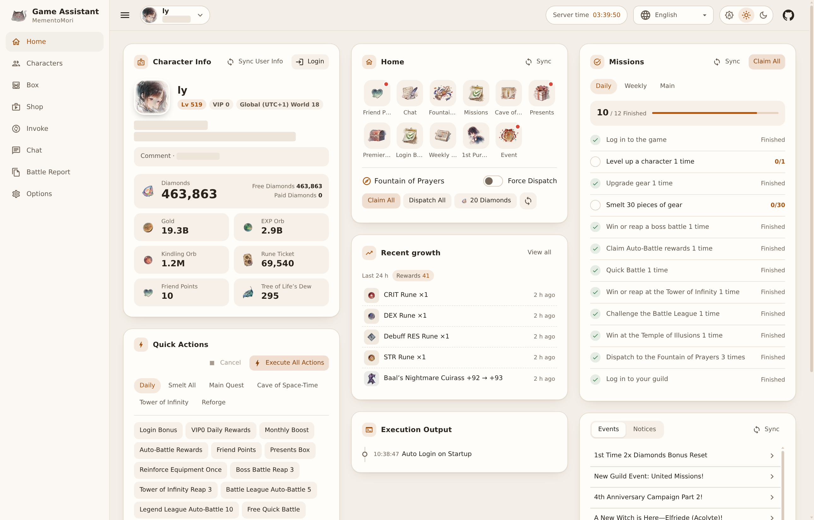
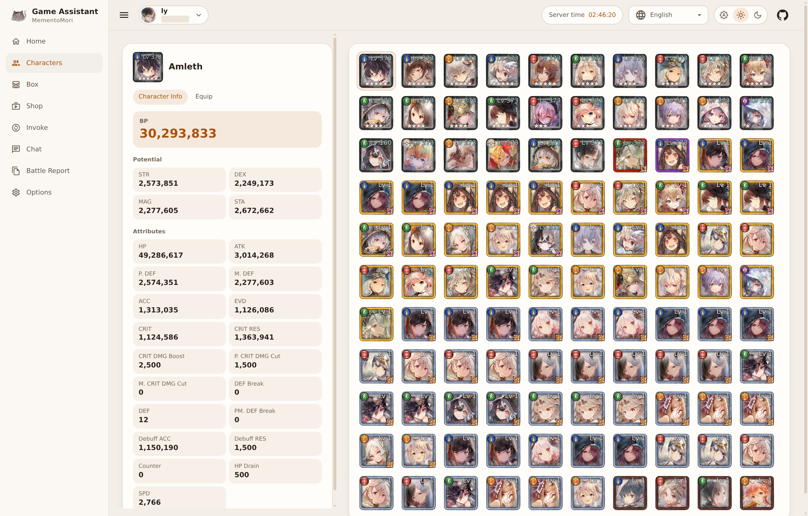
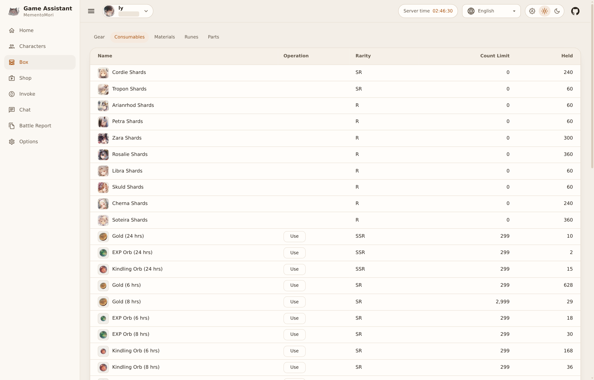
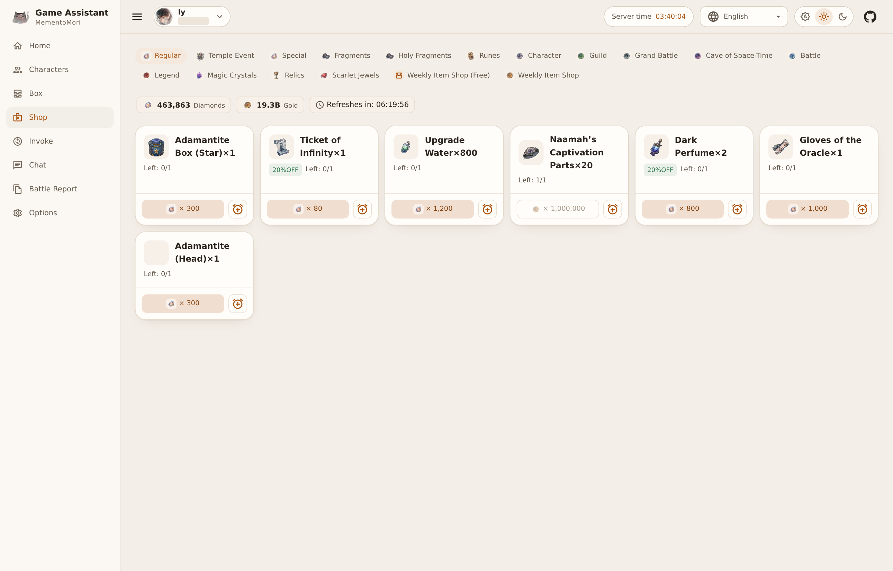
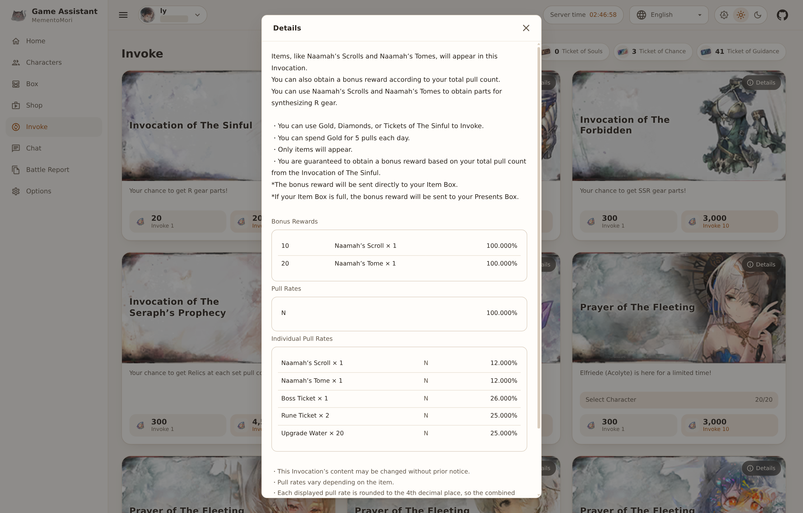
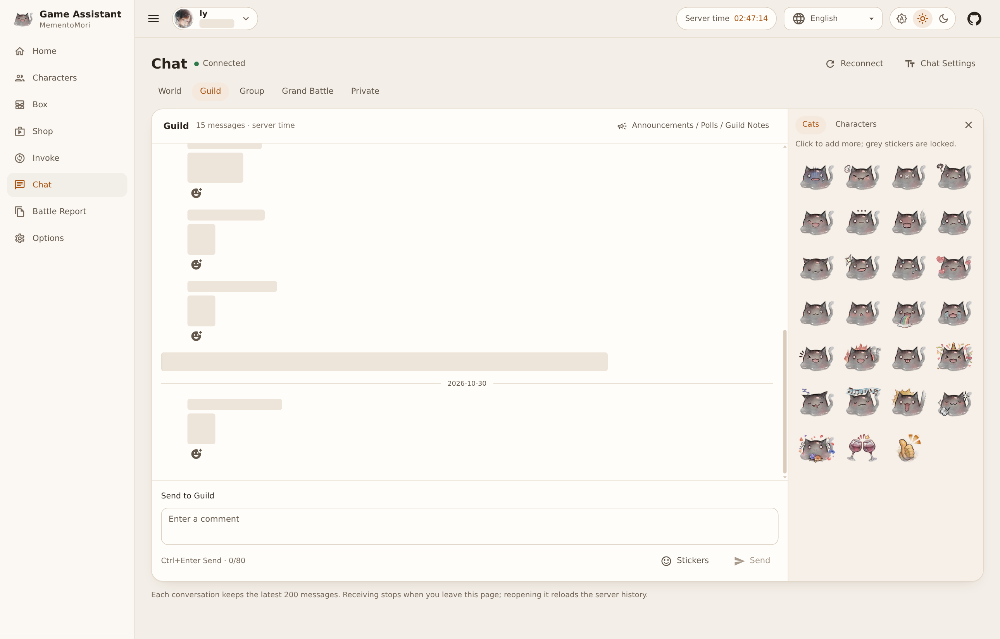
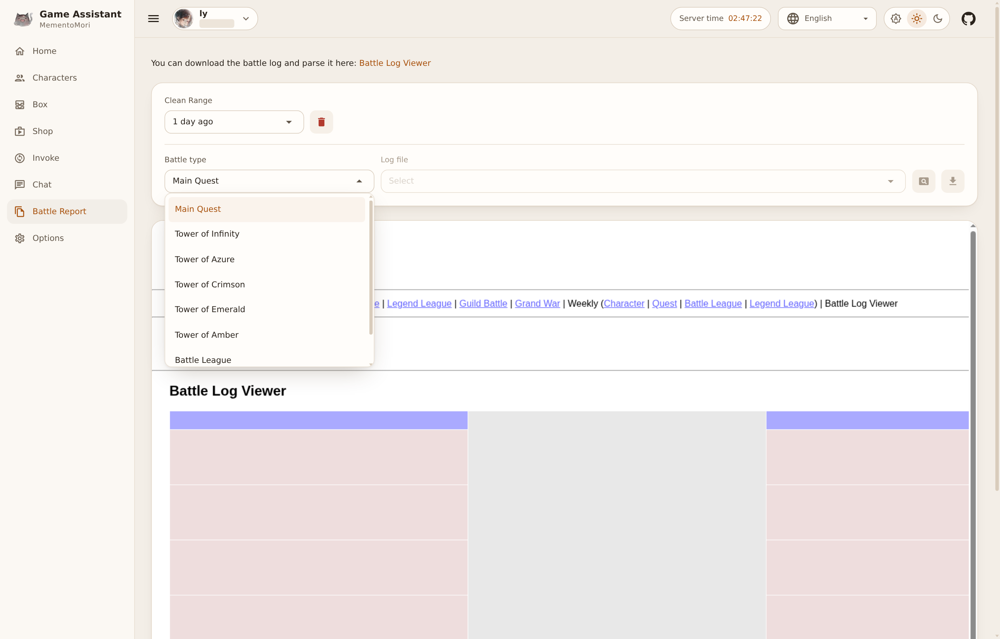
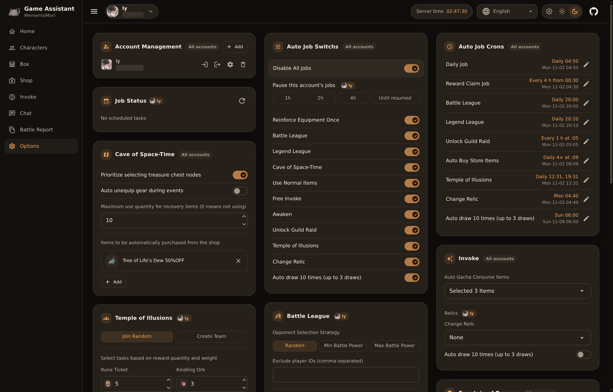

[ [Zh](readme.md) | [En](readme.en.md) ]

# MementoMori Game Assistant

[](https://github.com/lyaurora/mementomori-helper/actions/workflows/publish-dev.yml)

A web assistant for Memento Mori: it claims rewards and runs dailies on a schedule, and lets you view characters and items, buy, invoke and chat from a browser.

This is a maintained fork of [moonheart/mementomori-helper](https://github.com/moonheart/mementomori-helper) that keeps the original WebUI. It runs on .NET 10, its game protocol is synced to client 5.1.1, and the UI is available in English, 简体中文, 繁體中文, 日本語 and 한국어.

## **Disclaimer**

Please be aware of the following points when using this tool:

1. This tool is provided for personal entertainment and educational purposes. The use of this tool may violate the usage policies of specific games or applications, and users assume all associated risks.

2. The developer (referred to as "we") is not responsible for any legal or moral consequences that may arise from a user's use of this tool in games. Users should take full responsibility for the potential risks associated with using the tool.

3. Users should understand that developers of games or applications may take measures to detect and prevent the use of such assistance tools, which may result in users' accounts being banned or subjected to other sanctions.

4. Using this tool may potentially violate applicable laws. Users are responsible for ensuring that their usage complies with all relevant laws and regulations.

5. We reserve the right to change or discontinue this tool at any time without prior notice.

By downloading, installing, and using this tool, users acknowledge that they have carefully read and understood this disclaimer and agree to assume all risks associated with using this tool. If you do not agree with any part of this disclaimer, please discontinue the use of this tool.

## Previews

The screenshots use the English UI. Player IDs, comments and other players' information are masked.

<table>
<tbody>
<tr><td>

**Home**

</td><td>

**Characters**

</td></tr>
<tr><td>

**Box**

</td><td>

**Shop**

</td></tr>
<tr><td>

**Invoke details**

</td><td>

**Chat and stickers**

</td></tr>
<tr><td>

**Battle Report**

</td><td>

**Options (dark mode)**

</td></tr>
</tbody>
</table>

## Features

### Home

- Character info (including server and world) and main resources at a glance; Fountain of Prayers, mission and game notice panels. **Claim All** on the mission panel also claims medal rewards.
- **Quick actions**: run the whole daily routine at once or any single step (reward claims, sweeps, leagues, guild, Temple of Illusions, Guild Tree, auto-buy and more).
- Bulk-cast S/A/B/C equipment and inherit Matchless and Legend levels onto D equipment.
- Automatic main quest and Tower of Infinity (including the elemental towers) runs that can stop after a chosen stage; automatic Cave of Space-Time; manual equipment reforging.
- **Execution output**: every line has a time; failed actions are shown in red with the API that failed, so problems are easy to locate. A running action can be cancelled at any time.
- **Recent growth**: records rewards, character and equipment upgrades, and quest and tower progress, with category filters and a battle power trend.

### Other pages

- **Characters**: character list, stats and equipment details.
- **Box**: equipment, consumables, materials, runes and shards; items can be used by hand.
- **Shop**: browse the shops and buy; the alarm button on an item adds an auto-buy rule.
- **Invoke**: banner list, details and rates, character selection and manual draws.
- **Chat**: World, Guild, SvS, cross-world guild battle and private conversations; stickers, reactions, guild announcements, surveys and notes.
- **Battle Report**: browse saved logs by type (main quest, towers, Battle League, Legend League), download the JSON, open it in the embedded viewer, or clean up by age.
- **Options**: account management, automatic job switches and schedules, job status, and the automation settings.

### Multiple accounts

- Add several accounts and switch between them in the app bar. Each browser session picks its own current account; scheduled jobs run for all accounts.
- Each account keeps its own device ID across restarts.
- Scheduled jobs can be paused per account (1, 2 or 4 hours, or until resumed).
- A failed automatic login retries after 1, 2, 4, 8, then 15 minutes; the error and retry time are shown in Options.

### Interface

The appearance can follow the system or be set to light or dark, and the app bar shows the server time.

## Installation

Docker Compose is recommended. This repository does not currently publish release archives.

### Option 1: Docker Compose, built from source

```sh
git clone https://github.com/lyaurora/mementomori-helper.git
cd mementomori-helper/examples/docker-compose
mkdir -p config Master BattleLogs
test -f config/appsettings.user.json || printf '{}\n' > config/appsettings.user.json
chmod 600 config/appsettings.user.json
docker compose up -d --build
```

Then open `http://127.0.0.1:5290`. See [examples/docker-compose](examples/docker-compose/Readme.md) for more.

### Option 2: Docker Compose, prebuilt image

CI publishes the master branch to `ghcr.io/lyaurora/mementomori-helper:dev` (linux/amd64, linux/arm64). After preparing the directories above, replace `build`, `image` and `pull_policy` in the example `docker-compose.yml` with:

```yaml
    image: ghcr.io/lyaurora/mementomori-helper:dev
```

### Option 3: Run directly

Install the .NET 10 SDK selected by [global.json](global.json), then:

```sh
cd MementoMori.WebUI
dotnet run -c Release
```

By default it listens on port 5290 on all interfaces (`http://0.0.0.0:5290`) and keeps its configuration and data in the current directory.

> The WebUI has no login of its own. The example publishes the port on loopback only. For remote access use SSH, Tailscale or an authenticating reverse proxy; do not expose it directly to the internet.

## Adding an account

Go to **Options - Account Management - Add**, enter a name, the account (Transfer ID) and the password (Transfer Password), and enable automatic login if you want it. Then click **Login** on Home and choose the character to log in with.

The configuration is stored in `appsettings.user.json`. It contains each account's ClientKey, so do not share it.

## Automatic jobs

Times are in the server time of the account's world and can be changed under **Options - Auto Job Crons**. **Disable All Jobs** stops every job at once. **Job Status** shows the next run and the last result (cleared on restart).

| Job | Default time | Default switch | What it does |
| --- | --- | --- | --- |
| Daily Job | Every day 04:50 | Always runs | See the list below |
| Reward Claim Job | Every 4 hours from 00:30 | Always runs | See the list below |
| Battle League | Every day 20:00 | On | Fights until the attempts run out, then claims mission rewards |
| Legend League | Every day 20:10 | Off | Fights until the attempts run out |
| Unlock Guild Raid | Every hour on the hour | Off | Unlocks the guild raid |
| Auto Buy Store Items | Every day 09:09, 12:09, 15:09, 18:09 | Follows the rules; none by default | Buys items matching the rules and takes free items |
| Temple of Illusions | Every day 12:31, 19:31 | Off | Challenges the Temple of Illusions |
| Change Relic | Every Monday 04:40 | Off | Switches the relic invoke to the configured relic |
| Auto draw 10 times (up to 3 draws) | Every Sunday 06:00 | Off | Draws the relic invoke with free diamonds only; also needs this account's switch in the Invoke settings |

### Daily Job

- Claim login bonuses, the VIP daily gift, Monthly Boost, auto-battle rewards and the Presents Box
- Send and receive Friend Points
- Reinforce equipment once (switch, on by default): picks the lowest-level equipped item that is below its cap
- Sweep the boss and the Tower of Infinity 3 times each
- High-speed battle: the daily free one, plus Monthly Boost uses if active
- Guild check-in, Guild Raid, Guild Tree, Guild Battle rewards
- Friend management, friend campaign rewards, achievement rewards, character Memories
- Fountain of Prayers claim and dispatch
- Cave of Space-Time (switch, on by default)
- Mission and medal rewards, rental raid share rewards
- Use Normal Items (switch, on by default), free invoke (switch, on by default)
- Character Awaken (switch, on by default): R to R+ and SR to SR+; locked and level-linked characters are never used as material

### Reward Claim Job

- Login bonuses, Fountain of Prayers (claim and dispatch), the Presents Box, auto-battle rewards
- Guild Raid, Guild Tree, Guild Battle rewards
- Send and receive Friend Points
- Mission and medal rewards, rental raid share rewards, character Memories
- Free invoke and Use Normal Items (each follows its switch)

## Automation settings

These are on the **Options** page. Changes save automatically and the card title briefly shows "Saved"; **Reset to default** asks for confirmation first. The label on each card shows its scope: "All accounts" applies everywhere, and a character name applies to the current account only.

### Battle League, Legend League

The opponent strategy can be random (default), lowest or highest battle power. You can exclude player IDs and filter by character: exclude opponents who have a certain character, or whose character has a higher chosen stat than yours.

### Temple of Illusions

By default it joins existing rooms and hosts its own after failing to find one for a long time; it can also be set to always host. When hosting you can set the wait before the battle, and it stops after 3 losses in a row.

It picks among the open quests by reward weight; during events only event quests are considered. Each quest scores:

$$score=\sum weight\times\frac{count}{count_{max}}$$

$count$ is the quest's reward count (plus the first-clear reward if not cleared yet) and $count_{max}$ is the maximum reward of that item. The highest score wins, then the higher level.

### Fountain of Prayers

You can dispatch only quests with chosen rewards; **Force Dispatch** on Home ignores this setting. Refreshing quests with diamonds is off by default and can be limited to a maximum count per day.

### Cave of Space-Time

Options: prefer treasure chest nodes, remove and re-equip gear during events, the maximum number of recovery items, and which cave shop items to buy at what minimum discount.

### Shop auto-buy

A rule names the item to buy, the item to pay with and a minimum discount; at least one of the two items is required. Diamond prices count free diamonds only, so paid diamonds are never used. **Reset to Default** restores two rules: Tree of Life's Dew at 20% off with any item, and any general store item for gold.

### Invoke, items

- **Auto Gacha Consume Items**: what the free invoke may spend.
- **Items to use automatically**: which chest types Use Normal Items opens.

### Friends, Guild Tree

- Friends: remove friends inactive for 7 days (with a whitelist), accept and send friend requests automatically.
- Guild Tree: automatic entry, challenges (with a retry count), reinforcement and stage reward claims.

### Others

You can set a delay between requests, the asset server address and the battle log viewer address.

## FAQ

### How do I run multiple instances?

One instance already handles several accounts, so this is rarely needed. If you do:

- Docker: copy the `examples/docker-compose` directory and change `container_name` and the left side of `ports`.
- Running directly: give each instance its own working directory and set its port in that directory's `appsettings.user.json`, for example:

```json
{
  "Kestrel": {
    "Endpoints": {
      "Http": {
        "Url": "http://127.0.0.1:5700"
      }
    }
  }
}
```

### Icons or avatars do not show

Images are downloaded from the asset server (`list.moonheart.dev` by default) and cached locally. If that server is unavailable, cached images keep working; you can change the address under **Options - Others**.

### A job did not run

Check **Options - Job Status** first: the account must be logged in, **Disable All Jobs** and the account pause must be off, and the job's switch must be on.

### How do I upgrade?

Docker Compose: update the code and run `docker compose up -d --build` again, or with the prebuilt image run `docker compose pull && docker compose up -d`. Configuration, Master data and battle logs stay in the mounted directories.

## Maintenance

See the [maintenance guide](docs/maintenance.md) for builds, regression checks, game version updates and configuration migration.

## Credits

Thanks to [moonheart/mementomori-helper](https://github.com/moonheart/mementomori-helper) and its contributors.
