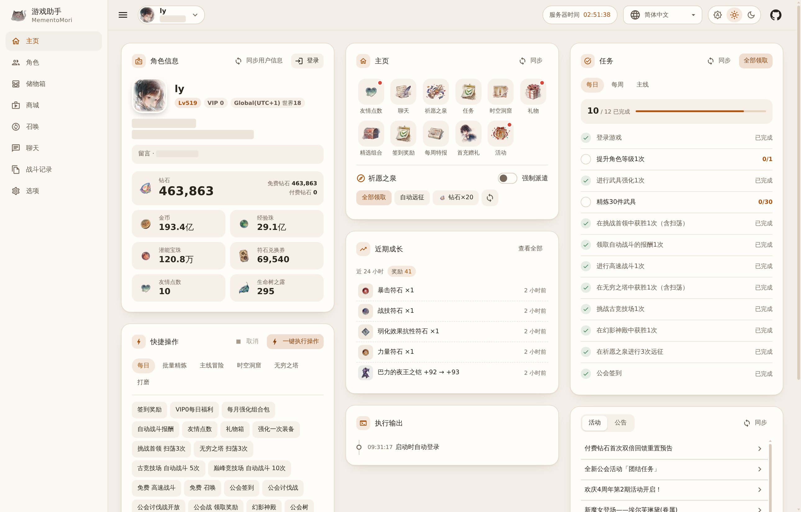
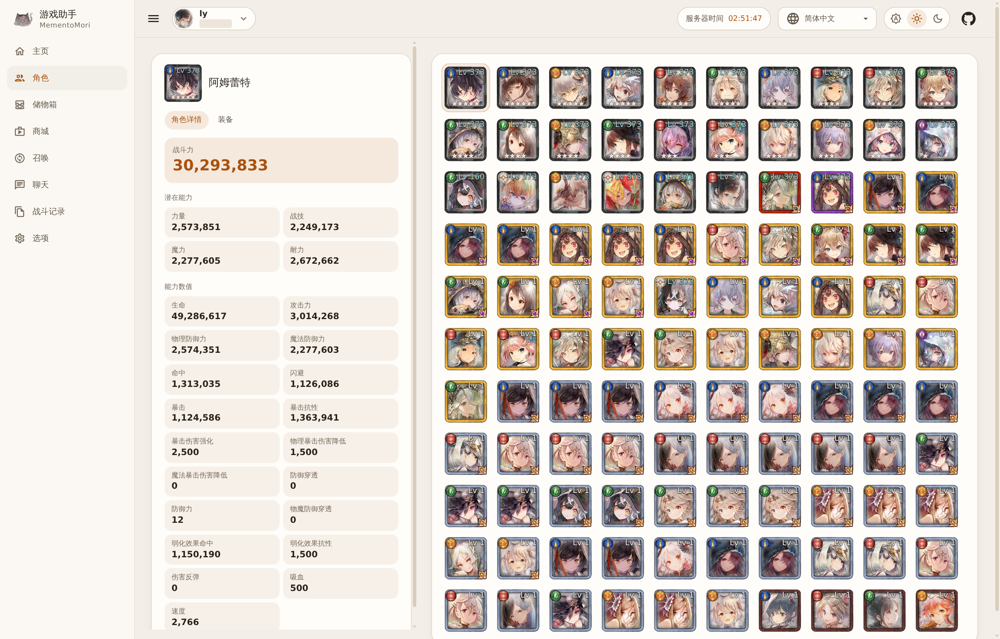
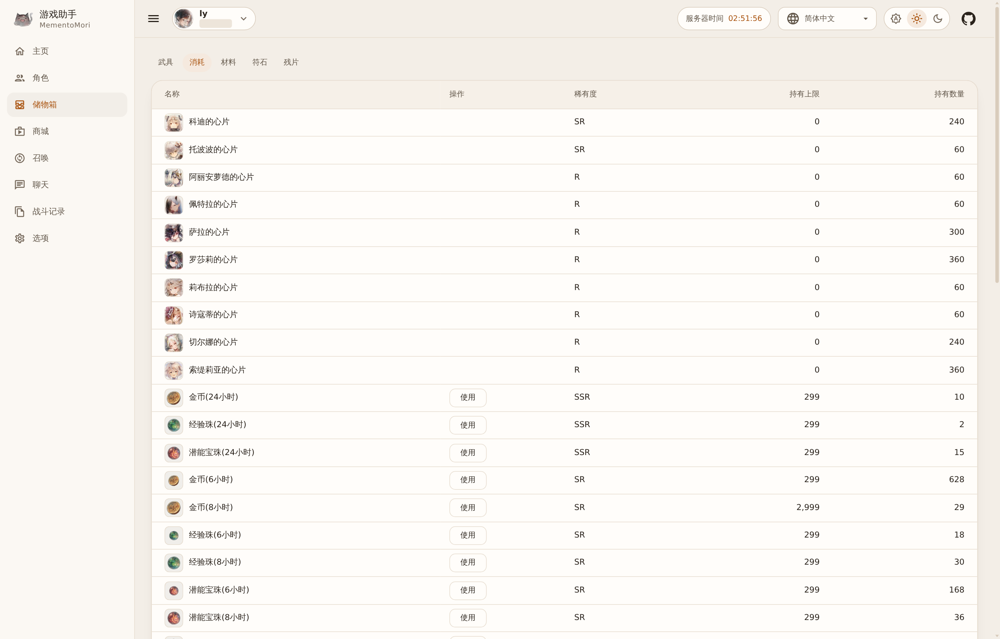
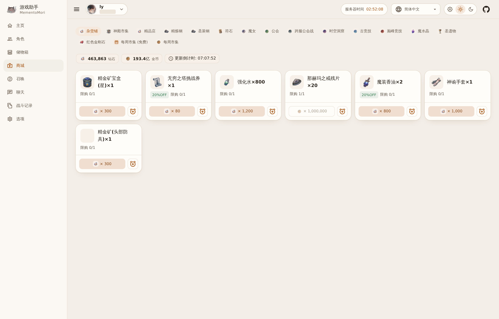
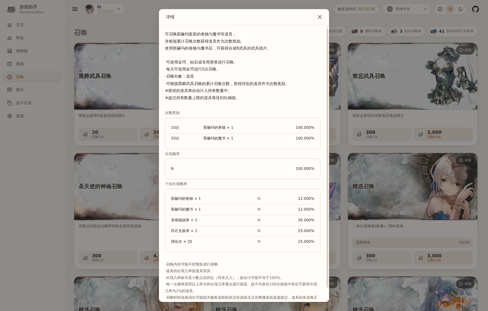
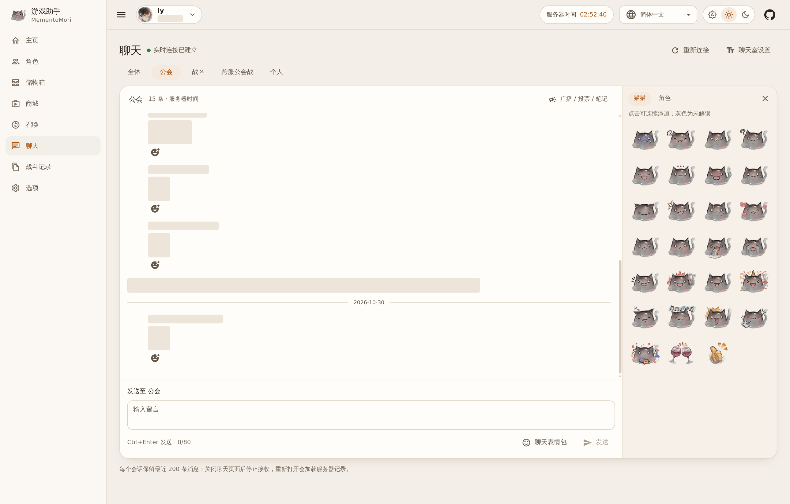
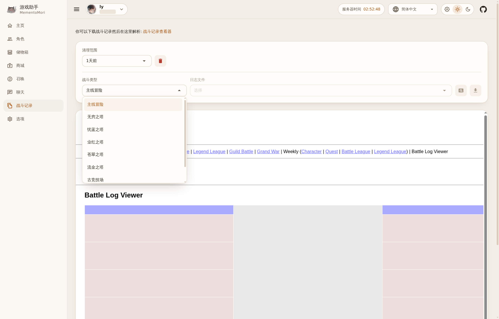
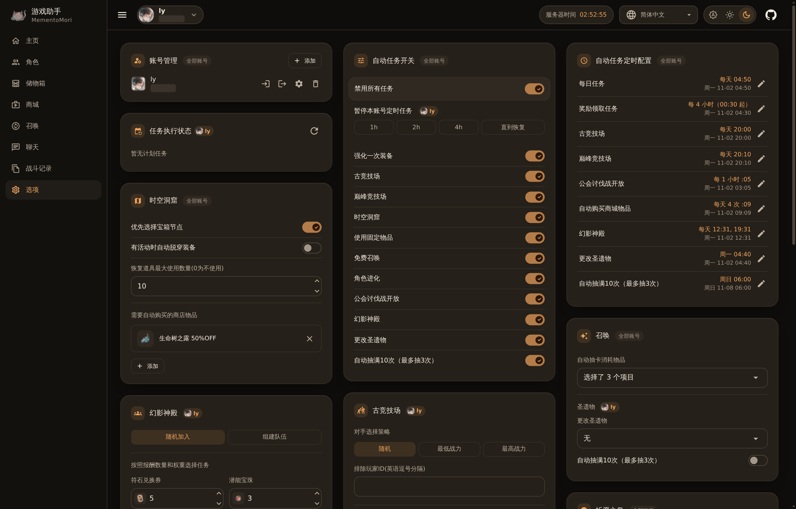

[ [Zh](readme.md) | [En](readme.en.md) ]

# MementoMori 游戏助手

[](https://github.com/lyaurora/mementomori-helper/actions/workflows/publish-dev.yml)

《メメントモリ》的网页版助手：定时领取奖励、完成日常，也可以在浏览器里查看角色和物品、购买、抽卡和聊天。

本项目是 [moonheart/mementomori-helper](https://github.com/moonheart/mementomori-helper) 的维护分支，继续维护原有的 WebUI。运行于 .NET 10，游戏协议已同步到客户端 5.1.1，界面支持简体中文、繁體中文、English、日本語、한국어。

## **免责声明**

使用本辅助工具的用户（以下简称“用户”）请注意以下几点：

1. 本辅助工具仅供个人娱乐和教育目的使用。使用本工具可能违反特定游戏或应用的使用政策，请自行承担风险。

2. 开发者（以下简称“我们”）不对用户在游戏中使用本工具所产生的任何后果负任何法律或道德责任。用户应自行承担使用工具可能带来的风险。

3. 用户需明白，游戏或应用的开发者可能会采取措施来检测并阻止辅助工具的使用，这可能导致用户的账户被封禁或受到其他制裁。

4. 使用本辅助工具可能违反适用法律。用户需确保自己的使用遵守所有适用法律和法规。

5. 我们保留随时更改或停止本辅助工具的权利，无需提前通知。

通过下载、安装和使用本辅助工具，用户表明已详细阅读并理解此免责声明，并同意自行承担使用本工具所带来的一切风险。如不同意本声明的任何部分，请停止使用本辅助工具。

## 预览

截图中的玩家 ID、留言和其他玩家信息已遮盖。

<table>
<tbody>
<tr><td>

**主页**

</td><td>

**角色**

</td></tr>
<tr><td>

**储物箱**

</td><td>

**商城**

</td></tr>
<tr><td>

**召唤详情**

</td><td>

**聊天与表情**

</td></tr>
<tr><td>

**战斗记录**

</td><td>

**选项（深色模式）**

</td></tr>
</tbody>
</table>

## 功能

### 主页

- 角色信息（含服务器和世界）和主要资源一览；祈愿之泉、任务和游戏公告面板。任务面板的 **全部领取** 会同时领取奖章奖励。
- **快捷操作**：一键执行日常，也可以单独执行每一项（奖励领取、扫荡、竞技场、公会、幻影神殿、公会树、自动购买等）。
- 批量精炼 S/A/B/C 装备并把魔装继承到 D 装，把圣装继承到 D 装。
- 主线和无穷之塔（含属性塔）自动挑战，可指定通过某一关后停止；时空洞窟自动执行；手动打磨装备。
- **执行输出**：每行带时间；失败的操作显示为红色，并标出出错的接口，方便定位。执行中可以随时取消。
- **近期成长**：记录奖励、角色和装备提升、主线与爬塔进度，可按类别筛选并查看战力趋势。

### 其他页面

- **角色**：角色列表、属性和装备详情。
- **储物箱**：武具、消耗、材料、符石、残片，可手动使用道具。
- **商城**：查看各商店并购买，点击商品上的闹钟按钮可添加自动购买规则。
- **召唤**：卡池列表、抽卡详情和概率、选择角色、手动抽卡。
- **聊天**：全体、公会、战区、跨服公会战和个人会话；表情、回应、公会公告、投票和笔记。
- **战斗记录**：按类型（主线、各塔、古竞技场、巅峰竞技场）查看助手保存的记录，可下载 JSON、在内嵌查看器中打开，或按时间范围清理。
- **选项**：账号管理、自动任务开关和定时、任务执行状态，以及各项自动化设置。

### 多账号

- 可添加多个账号，顶栏切换。每个浏览器会话单独选择当前账号，定时任务对所有账号同时运行。
- 每个账号固定使用自己的设备 ID，重启后不变。
- 可以单独暂停某个账号的定时任务（1 / 2 / 4 小时或直到恢复）。
- 自动登录失败后按 1、2、4、8、15 分钟的间隔重试，错误和重试时间显示在选项页。

### 界面

外观可选跟随系统、浅色、深色，顶栏显示服务器时间。

## 部署

推荐使用 Docker Compose。本仓库目前没有发布 Release 压缩包。

### 方式 1：Docker Compose，从源码构建

```sh
git clone https://github.com/lyaurora/mementomori-helper.git
cd mementomori-helper/examples/docker-compose
mkdir -p config Master BattleLogs
test -f config/appsettings.user.json || printf '{}\n' > config/appsettings.user.json
chmod 600 config/appsettings.user.json
docker compose up -d --build
```

然后打开 `http://127.0.0.1:5290`。更多说明见 [examples/docker-compose](examples/docker-compose/Readme.md)。

### 方式 2：Docker Compose，使用预构建镜像

CI 会把 master 分支发布到 `ghcr.io/lyaurora/mementomori-helper:dev`（linux/amd64、linux/arm64）。准备好上面的目录后，把示例 `docker-compose.yml` 中的 `build`、`image` 和 `pull_policy` 换成：

```yaml
    image: ghcr.io/lyaurora/mementomori-helper:dev
```

### 方式 3：直接运行

安装 [global.json](global.json) 指定的 .NET 10 SDK，然后：

```sh
cd MementoMori.WebUI
dotnet run -c Release
```

默认监听所有网卡的 5290 端口（`http://0.0.0.0:5290`），配置和数据保存在当前目录。

> WebUI 本身没有登录验证。示例只把端口发布到本机，需要远程访问时请通过 SSH、Tailscale 或带认证的反向代理，不要直接暴露到公网。

## 添加账号

进入 **选项 - 账号管理 - 添加**，填写名称、账号（引继 ID）和密码（引继密码），按需打开自动登录。之后在主页点击 **登录** 选择要登录的角色。

配置保存在 `appsettings.user.json`，里面有账号的 ClientKey，请勿外传。

## 自动任务

时间均为账号所在服务器的时间，可在 **选项 - 自动任务定时配置** 中修改。**禁用所有任务** 可以一次停用全部任务；**任务执行状态** 显示下次执行时间和上次结果（重启后清空）。

| 任务 | 默认时间 | 默认开关 | 内容 |
| --- | --- | --- | --- |
| 每日任务 | 每天 04:50 | 始终执行 | 见下方列表 |
| 奖励领取任务 | 每天 00:30 起每 4 小时 | 始终执行 | 见下方列表 |
| 古竞技场 | 每天 20:00 | 开 | 自动战斗到次数用完，然后领取任务奖励 |
| 巅峰竞技场 | 每天 20:10 | 关 | 自动战斗到次数用完 |
| 公会讨伐战开放 | 每小时整点 | 关 | 开放公会讨伐战 |
| 自动购买商城物品 | 每天 09:09、12:09、15:09、18:09 | 按规则执行，默认无规则 | 购买符合规则的商品，并领取免费商品 |
| 幻影神殿 | 每天 12:31、19:31 | 关 | 自动挑战幻影神殿 |
| 更改圣遗物 | 每周一 04:40 | 关 | 把圣天使召唤切换到设置的圣遗物 |
| 自动抽满10次（最多抽3次） | 每周日 06:00 | 关 | 只用免费钻石抽圣遗物召唤，还需要在召唤设置中打开本账号的开关 |

### 每日任务

- 领取签到奖励、VIP 每日福利、每月强化组合包、自动战斗报酬、礼物箱
- 赠送和领取友情点数
- 强化一次装备（开关，默认开）：选择已装备且等级最低、未达上限的装备
- 挑战首领和无穷之塔各扫荡 3 次
- 高速战斗：每日免费一次，有月卡时再用月卡次数
- 公会签到、公会讨伐战、公会树、领取公会战奖励
- 好友管理、好友活动奖励、成就奖励、角色回忆
- 祈愿之泉领取和远征
- 时空洞窟（开关，默认开）
- 领取任务奖励和奖章奖励、租借讨伐分享奖励
- 使用固定物品（开关，默认开）、免费召唤（开关，默认开）
- 角色进化（开关，默认开）：R 合成 R+，SR 合成 SR+；已锁定或在等级链接中的角色不会被当作素材

### 奖励领取任务

- 领取签到奖励、祈愿之泉（领取并远征）、礼物箱、自动战斗报酬
- 公会讨伐战、公会树、领取公会战奖励
- 赠送和领取友情点数
- 领取任务奖励和奖章奖励、租借讨伐分享奖励、角色回忆
- 免费召唤、使用固定物品（各自受开关控制）

## 自动化设置

设置项在 **选项** 页，修改后自动保存，卡片标题旁会短暂显示“保存成功”；**重置为默认** 会先确认。卡片上的标记表示作用范围：“全部账号”对所有账号生效，显示角色名的只对当前账号生效。

### 古竞技场、巅峰竞技场

对手选择策略可选随机（默认）、最低战力或最高战力。可以排除指定玩家 ID，也可以按角色筛选：排除带有某角色的对手，或排除某角色指定属性高于自己的对手。

### 幻影神殿

默认加入已有房间，长时间找不到房间时改为自己开房；也可以设置为始终自己开房。自己开房时可设置开战前的等待秒数，连败 3 次后停止。

在开放的任务中按报酬权重选择，活动期间只选活动任务。每个任务的得分为：

$$score=\sum weight\times\frac{count}{count_{max}}$$

其中 $count$ 是任务报酬数量（首次通关时加上首通奖励），$count_{max}$ 是该物品的报酬上限。选择得分最高的任务，得分相同时选等级高的。

### 祈愿之泉

可以设置仅派遣包含指定报酬的任务；主页的 **强制派遣** 可以忽略这项设置。钻石刷新任务默认关闭，可设置每天的最大刷新次数。

### 时空洞窟

可设置优先选择宝箱节点、活动时自动脱穿装备、恢复道具最大使用数量，以及要在洞窟商店购买的商品和最低折扣。

### 商城自动购买

规则可以指定购买的物品、消耗的物品和最低折扣，物品和消耗品至少指定一个。钻石价格只按免费钻石计算，不会动用付费钻石。选项页的 **重置为默认** 会恢复两条默认规则：用任意物品购买 20%OFF 的生命树之露，以及用金币购买杂货铺的任意物品。

### 召唤、物品

- **自动抽卡消耗物品**：免费召唤时可以消耗的物品。
- **自动使用的物品**：使用固定物品时打开哪些类型的宝箱。

### 好友、公会树

- 好友：自动移除 7 天未登录的好友（可设白名单）、自动同意和自动发送好友申请。
- 公会树：自动报名、挑战（可设重试次数）、强化和领取阶段奖励。

### 其他

可设置请求之间的延迟、资源服务器地址和战斗记录查看器地址。

## 常见问题

### 如何多开？

一个实例就可以管理多个账号，通常不需要多开。确实需要时：

- Docker：复制一份 `examples/docker-compose` 目录，修改 `container_name` 和 `ports` 左侧的端口。
- 直接运行：为每个实例使用单独的工作目录，并在该目录的 `appsettings.user.json` 中修改端口，例如：

```json
{
  "Kestrel": {
    "Endpoints": {
      "Http": {
        "Url": "http://127.0.0.1:5700"
      }
    }
  }
}
```

### 图标或头像显示不出来？

图片从资源服务器（默认 `list.moonheart.dev`）下载并缓存到本地。如果该服务器不可用，已缓存的图片仍可显示；可以在 **选项 - 其他** 中改用其他地址。

### 自动任务没有执行？

先看 **选项 - 任务执行状态**：账号需要已登录，**禁用所有任务** 和账号暂停都要处于关闭状态，对应任务的开关要打开。

### 如何升级？

Docker Compose：更新代码后重新运行 `docker compose up -d --build`，或在使用预构建镜像时运行 `docker compose pull && docker compose up -d`。配置、Master 和战斗记录都保存在挂载的目录中。

## 维护

构建、回归检查、游戏版本同步和配置迁移见 [维护说明](docs/maintenance.md)。

## 致谢

感谢 [moonheart/mementomori-helper](https://github.com/moonheart/mementomori-helper) 及其贡献者。
